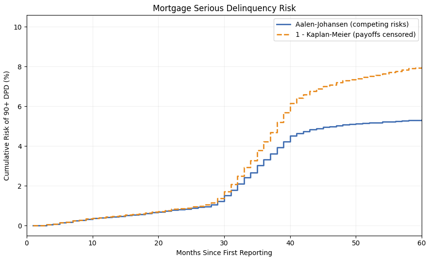
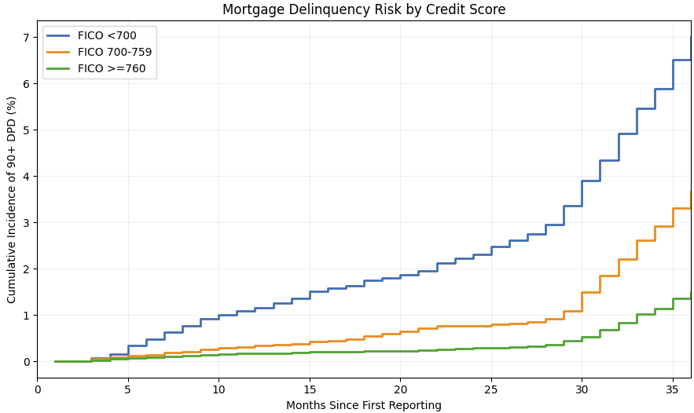
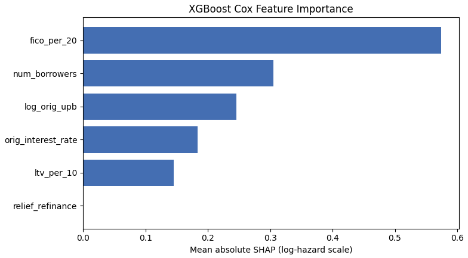
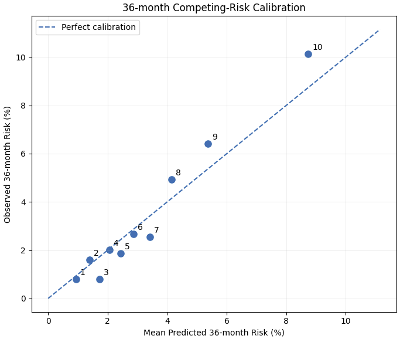

# Mortgage Serious Delinquency Prediction with Competing Risks

**An end-to-end mortgage credit-risk modeling project using PySpark, Delta Lake, survival analysis, cause-specific Cox models, and XGBoost.**

**Tech stack:** Databricks · PySpark · Delta Lake · Python · lifelines · XGBoost · scikit-learn · SHAP · Matplotlib

> **Key takeaway:** On a held-out test set of 7,498 mortgages, cause-specific Cox and XGBoost models achieved similar 36-month discrimination (**AUC 0.707 vs. 0.709**). The top 30% of loans ranked by either model captured **58.2% of observed serious-delinquency events**. XGBoost produced a smaller high-risk calibration gap, but its overall predictive advantage was modest.

## Project overview

**Business question:** *What is the probability that a mortgage will first reach 90+ days past due (DPD) within the next 12, 24, or 36 months?*

Predicting *when* serious delinquency occurs is different from predicting whether a loan will ever default. Mortgages can also be paid off before becoming seriously delinquent, making payoff a **competing risk**. This project builds a loan-level time-to-event dataset from monthly performance histories, estimates cumulative incidence, compares interpretable and machine-learning survival models, and evaluates both **discrimination** and **probability calibration**.

The event is **first observed 90+ DPD since the loan's first available reporting month**—not lifetime default, foreclosure, charge-off, or delinquency measured from origination.

### Project at a glance

| Item | Value |
|---|---:|
| Data source | Freddie Mac Single-Family Loan-Level Dataset, **2017 sample** |
| Origination records | **50,000** mortgages |
| Monthly performance records | **2,837,053** |
| Monthly reporting coverage | **Jan 2017–Jun 2026** |
| Eligible survival-analysis loans | **49,968** |
| Loans with an observed 90+ DPD event over follow-up | **2,927** |
| Held-out test loans | **7,498** |
| Held-out 36-month 90+ DPD events | **275** |

## 1. Data engineering and outcome construction

I ingested the pipe-delimited origination and monthly performance files into **Delta tables** using **PySpark**, joined records by loan ID, and constructed one observation per mortgage with an event time and event type.

**Event definitions**

| Event code | Outcome | Loans |
|---|---|---:|
| `1` | First observed 90+ DPD | 2,927 |
| `2` | Paid off / matured | 36,128 |
| `3` | Other termination | 83 |
| `0` | Administrative censoring | 10,830 |

For competing-risk prediction, payoff and other termination (`2` and `3`) are combined into the competing-exit cause. Time is measured in **months since the first observed performance report**, the first time point with reliable observed loan history.

**Quality checks:** Zero unmatched origination/performance loan IDs, zero duplicate loan-month observations, zero invalid reporting dates, and zero monthly gaps before the modeled exit. I also resolved zero-follow-up records, post-cutoff termination dates, and same-month event/termination ties using documented rules.

**Feature engineering:** The final common baseline feature set contains original FICO, loan-to-value ratio (LTV), interest rate, log original unpaid principal balance (UPB), number of borrowers, and a relief-refinance indicator. Only information available at the prediction baseline was used.

An important data-quality finding was **structural missingness in debt-to-income ratio (DTI)**: all 1,804 relief-refinance loans had missing original DTI. Rather than applying an indiscriminate median imputation, I excluded DTI from the common six-feature baseline and retained the relief-refinance indicator. Missing FICO values were imputed using the **training-set median only**.

**Loan-level split:** 70% training (34,975), 15% validation (7,495), and 15% untouched test (7,498), stratified by outcome type. All performance months for a mortgage remained in the same split.

## 2. Why competing risks matter

A standard **1 − Kaplan–Meier** curve that treats payoff as noninformative censoring does not estimate the actual-world probability of serious delinquency when loans may be paid off first. I therefore estimated cause-specific cumulative incidence using the **Aalen–Johansen estimator**.



**Training-set cumulative incidence:**

| Horizon | Aalen–Johansen CIF | 1 − Kaplan–Meier |
|---|---:|---:|
| 12 months | 0.42% | 0.43% |
| 24 months | 0.84% | 0.89% |
| **36 months** | **3.32%** | **4.22%** |

At 36 months, `1 − KM` was **0.90 percentage points higher**, or approximately **27% higher relative to the AJ estimate**. This underscores the importance of defining the right probability estimand instead of treating early payoff as ordinary censoring.

### Credit-score risk stratification



| Original FICO group | Training loans | 36-month AJ CIF |
|---|---:|---:|
| < 700 | 6,493 | **7.01%** |
| 700–759 | 12,856 | **3.67%** |
| ≥ 760 | 15,619 | **1.49%** |

The lowest-FICO group had about **4.7 times** the 36-month cumulative incidence of the highest-FICO group. These are **unadjusted associations**, not causal effects of changing a credit score.

## 3. Survival modeling and interpretability

### Cause-specific Cox baseline

I fit a regularized **cause-specific Cox proportional-hazards model** for first 90+ DPD, treating competing exits as censored for the purpose of estimating its cause-specific hazard. Selected adjusted hazard ratios were:

| Predictor increment | Hazard ratio | Interpretation |
|---|---:|---|
| FICO +20 points | **0.815** | ~18.5% lower cause-specific hazard |
| LTV +10 percentage points | **1.077** | ~7.7% higher cause-specific hazard |
| Interest rate +1 percentage point | **1.587** | ~58.7% higher cause-specific hazard |
| One additional borrower | **0.609** | ~39.1% lower cause-specific hazard |

A **Schoenfeld-residual diagnostic** suggested non-proportionality for FICO (rank-transform test *p* ≈ 0.00018). These hazard ratios are conditional associations; the model should not be interpreted as causal or assumed to satisfy proportional hazards perfectly.

### XGBoost Cox and SHAP

I trained an **XGBoost survival:cox** model on the same six baseline predictors, using validation-based early stopping. XGBoost captures nonlinear relationships between predictors and the log-relative hazard, although it **still imposes a proportional-hazards structure over time**.



**FICO** had the largest mean absolute SHAP contribution, followed by number of borrowers and log original loan balance. SHAP describes how predictors contribute to this fitted model's **log-relative-hazard output**; it is neither an individual delinquency probability nor a causal explanation.

For context, validation Harrell C-indices were **0.7306 (Cox)** and **0.7369 (XGBoost)**. These rank cause-specific hazard scores and are not interchangeable with the fixed-horizon CIF AUC reported below.

## 4. Personalized competing-risk probability prediction

A relative hazard score alone does not answer the business question. I fit **two cause-specific models per method**:

1. **Cause 1:** first observed 90+ DPD.
2. **Cause 2:** payoff or other recorded termination.

For XGBoost, I estimated cause-specific **Breslow baseline cumulative-hazard increments using training data only**, combined them with each mortgage's predicted relative hazards, and aggregated the two causes into a **personalized cumulative incidence function (CIF)**. A monthly piecewise-constant hazard approximation produced predicted **12-, 24-, and 36-month serious-delinquency probabilities**. The Cox models were combined using the same competing-risk framework.

This distinguishes **risk ranking** (who is riskier) from **absolute risk estimation** (what probability should be assigned).

### Validation calibration (Cox CIF)



*The plot above is for the **Cox CIF model on the validation set**, not the final test set or the XGBoost model.* Overall validation mean predicted 36-month risk was **3.31%**, versus **3.38% observed**. However, the highest-risk deciles showed some underprediction, demonstrating why good calibration on average does not guarantee reliable probabilities across risk groups.

## 5. Held-out test results

**Primary evaluation:** a fixed **7,498-loan internal test set**, not used for training, early stopping, or hyperparameter tuning. For the 12/24/36-month horizons, no administrative censoring occurred before those horizons in this test set; the observed event-by-horizon indicator could therefore be evaluated directly. Loans paid off before a horizon remained noncases for first 90+ DPD.

### Fixed-horizon discrimination

| Prediction horizon | Observed 90+ DPD events | Cox CIF AUC | XGBoost CIF AUC |
|---|---:|---:|---:|
| 12 months | 23 | **0.7913** | 0.7690 |
| 24 months | 60 | **0.7954** | 0.7851 |
| **36 months** | **275** | 0.7074 | **0.7094** |

Although XGBoost performed slightly better on all validation horizons, this advantage **did not consistently generalize to the test set**. The two models achieved virtually identical discrimination at 36 months. The 12- and 24-month AUCs should be interpreted cautiously because their case counts were small.

### Absolute-risk calibration and Brier score at 36 months

| Metric | Cox CIF | XGBoost CIF |
|---|---:|---:|
| AUC | 0.7074 | 0.7094 |
| Brier score (rounded) | 0.0346 | 0.0346 |
| Observed incidence | 3.6676% | 3.6676% |
| Mean predicted risk | 3.2987% | 3.2898% |
| Predicted minus observed | −0.369 pp | −0.378 pp |

Both models **underestimated average 36-month risk** on the held-out test set. Similar AUCs do not imply similar calibration across the full range of predictions.

### Highest-risk 30%: event capture and calibration

Each model independently ranked loans by predicted **36-month CIF** and selected the highest-risk 30%.

| Test-set metric | Cox CIF | XGBoost CIF |
|---|---:|---:|
| Loans flagged | 2,250 | 2,250 |
| 36-month events captured | 160 | 160 |
| **Share of all 36-month events captured** | **58.2%** | **58.2%** |
| Mean predicted risk in flagged group | 6.058% | 6.676% |
| Observed risk in flagged group | 7.111% | 7.111% |
| Underprediction (observed − predicted) | 1.053 pp | **0.435 pp** |

**Business interpretation:** Prioritizing the highest-scoring 30% of mortgages would identify about **58% of observed 36-month serious-delinquency events** in this retrospective test sample. XGBoost's mean probability was closer to observed incidence in its selected high-risk group, but **both models captured exactly the same number of events**. The two selected groups need not contain the same individual loans.

**Model-selection conclusion:** XGBoost is a useful nonlinear candidate and visualization model, but its gains over the more interpretable Cox baseline are **modest, not decisively established**. In the validation set, the paired bootstrap 95% interval for the 36-month AUC difference (XGBoost − Cox) was **[−0.0021, 0.0169]**, which included zero.

## 6. Limitations and next steps

- **Internal validation only.** All loans come from the 2017 sample; there is no external or out-of-time validation on other vintages or market regimes.
- **Observation starts at the first report**, not necessarily origination. An earlier, unobserved history is not reconstructed.
- **Event definitions depend on monthly reporting.** Same-month 90+ DPD and termination were prioritized as delinquency in the main analysis; monthly resolution and tied-event approximations limit temporal precision.
- **Termination codes may be heterogeneous.** Certain non-payoff terminations could reflect transfer or incomplete observation; treating all of them as competing events warrants sensitivity analysis.
- **Proportional-hazards limitation.** The FICO diagnostic raised evidence of time-varying effects; XGBoost `survival:cox` does not address this automatically.
- **Calibration and generalization.** Both models underestimated mean 36-month test risk. Further validation, potential recalibration, and subgroup/fairness evaluation would be necessary before operational use.

Natural follow-ups include testing on newer origination vintages, analyzing termination/tie assumptions, and evaluating discrete-time or non-PH competing-risk models.

## 7. Repository structure and reproducibility

```text
mortgage-delinquency-survival-prediction/
├── README.md
├── notebooks/                           # Exported Databricks notebooks 01–08
└── figures/
    ├── aj_vs_km.png
    ├── fico_risk_stratification.png
    ├── shap_importance.png
    └── calibration_36m_validation.png
```

**Notebook workflow:** `01–05` data ingestion, audits, time-to-event construction, features, and loan-level split → `06` nonparametric competing-risk analysis → `07` Cox/XGBoost models, diagnostics, and SHAP → `08` cause-specific CIF models, validation calibration, and **final held-out test evaluation**. “09 / final test” describes the logical project stage; the final test code is currently at the **end of Notebook 08**, not in a separate Notebook 09.

**To reproduce:**

1. Obtain the 2017 sample through the [official Freddie Mac Single-Family Loan-Level Dataset page](https://www.freddiemac.com/research/datasets/sf-loanlevel-dataset) and review its terms of use.
2. Import the numbered `.ipynb` notebooks into Databricks, configure your own catalog/schema and file paths, and run them in sequence.
3. The analysis uses Databricks/PySpark/Delta Lake and Python packages including `pandas`, `numpy`, `lifelines`, `xgboost`, `scikit-learn`, and `matplotlib`.
4. Notebook 08's final evaluation uses the fitted models and training-derived baseline hazards from the same notebook session; no separate serialized model artifact is required for the documented analysis workflow.

**Data access and redistribution:** Raw Freddie Mac files, loan-level extracts, and individual predictions are **not included** in this repository. Users should obtain data from Freddie Mac and comply with the applicable use and redistribution terms. Figures and tables here summarize this noncommercial portfolio analysis; they do not contain loan-level records.

---

*Portfolio demonstration of statistical risk modeling—not a production underwriting, servicing, or lending-decision system.*

